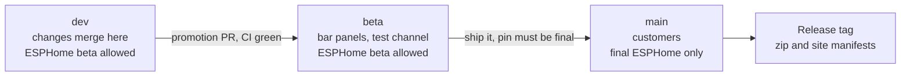

# Contributing

Thanks for helping with Game Day Scoreboard. Bug reports from people
running it are the most useful thing you can send.

## Where help is wanted

The firmware is open source so anyone with an ESP32-S3 and a HUB75 panel
can run it, and so the people running it can make it better. You don't
need to know ESPHome to help. These are the places where help goes
furthest right now:

- Watch a game on it and tell us what it got wrong. Live scoring is
  where the bugs are: overtime, a rain delay, a postponed game, a score
  ESPN takes back a play later. An issue with the league, the time and a
  photo of the panel is enough to go on.
- Record the ESPN response for a game we have no test for. The host tests
  run against real ESPN documents in `tests/fixtures`. Its README lists
  the ones we have and how each was recorded: `curl` with the User-Agent
  ESPN accepts, while the game is in the state you want. A rain delay, a
  suspended baseball game, an NFL game in overtime or a college
  basketball game in progress, saved as a fixture with a test for what
  the panel should show, stays covered from then on. This one needs only
  curl, g++ and some C++.
- Get it running on a board we haven't tested, like the Waveshare
  ESP32-S3 RGB Matrix. A pin map in `firmware/controllers/` and a line on
  the [DIY page](docs/site/diy/index.html) make a good first pull
  request. Say which panel you used and how long it ran.
- The device page is plain HTML and JavaScript in `firmware/web`, with
  browser tests in `tests/web`. Fixes for small phones, keyboard use and
  screen readers are welcome.
- If a step in the README or on the site tripped you up, a fix to the
  wording helps the next person as much as a code change.

A new league, a new screen or anything else that changes what the panel
shows: open an issue first so we can agree on it before you build it.

## Reporting a bug or asking for a feature

[Open an issue](https://github.com/gameday-scoreboard/gameday-scoreboard/issues/new/choose)
and pick the bug or feature form. For a bug, the firmware version (the
Firmware row on the panel's page), the controller and the panel layout
save a round of questions. A photo or short video of the panel helps
more than anything.

Issues are public. Leave out Wi-Fi passwords and anything else private.

Bought a scoreboard and need help with it? The
[docs](https://docs.gameday-scoreboard.com/) cover setup, every setting
and the common fixes, and the
[support page](https://install.gameday-scoreboard.com/support/) has the support
email, which answers faster than an issue.

## Changing the code

1. Fork the repo and branch from `dev`.
2. Make the change and test it (below).
3. Open a pull request against `dev`. `beta` and `main` only take
   promotion PRs from the maintainers, and CI fails anything else.

For anything bigger than a fix, open an issue first so we can agree on
the shape before you spend the time.

### Branches and ESPHome versions

Work lands in `dev`, moves to `beta` (the test channel that the bar
panels install from), and then to `main`, which customers run. `dev` and
`beta` may build on an ESPHome beta. `main`, and so every release tag and
the update feed, builds only on a final ESPHome release. CI checks it: the
pin is `ESPHOME_VERSION` at the top of `.github/workflows/build.yml`, and
the Branch rules job fails a PR into `main` or a release tag when that pin
isn't a final release like `2026.10.0`.



When `dev` is on a beta pin, the final ships first: the pin moves on
`dev`, `dev` is promoted to `beta`, the bar panels run it for a night, and
then `beta` is promoted to `main`. What customers get is what the beta
channel ran.

A fix we want that is only in an ESPHome beta, in order:

1. Copy the component into `components/` and stay on the final release.
   The Bluetooth setup component is carried this way today.
2. Wait for the final, or ask upstream for a backport to a patch release.
   An ESPHome beta runs about two weeks.
3. The maintainer's `esphome-beta-ok` label on the promotion PR, for a
   fix customers can't wait for. Add it, then re-run the Branch rules job;
   the release tag on that PR's merge passes too.

### Setup

- [ESPHome](https://esphome.io/) 2026.10.0b3, the version CI builds with.
- g++ for the host tests.
- Node and Python 3 for the device page tests.

### Build and test

```
esphome compile firmware/gameday.yaml
esphome compile firmware/gameday-scoreboard75.yaml
make -C tests
```

Use `compile`, not `config`: `config` doesn't catch C++ errors.

The device page has browser tests against a mock panel. In `tests/web`,
run `npm ci` and `npx playwright install chromium` once, then `npm test`.

If you edit `firmware/web/app.js` or `app.css`, run
`python scripts/build_web.py` and commit the regenerated `bundle.js`. CI
fails the PR if it is stale.

If you change what the panel does, run it on a panel for a while
(during a game if the change touches live scoring) and say in the PR
what you tested on: controller, layout, how long, what it showed.

### Docs

The docs at [docs.gameday-scoreboard.com](https://docs.gameday-scoreboard.com/)
are built from `docs/wiki` (Astro + Starlight). GitHub Pages publishes
this repo's `main`, so they always describe what customers run. If your change alters what
the panel shows, a setting, a button hold or anything else an owner or
DIY builder would notice, update or add the page for it under
`docs/wiki/src/content/docs/` in the same pull request. CI fails a PR
into `dev` that changes `firmware/` or `components/` without a docs
change; a maintainer adds the label `docs: not needed` when nothing
visible changed. `docs/wiki/README.md` has the page conventions, and
`npm install` then `npm run dev` in `docs/wiki` previews the site.

### Style

- Match the code around your change.
- Commit messages are one plain sentence about what changed for the
  person watching the panel, like "Name each panel's hotspot after its
  suffix".
- Leave the version number and CHANGELOG.md alone; the maintainers write
  both when a release goes out.

### Things we won't merge

- Passwords or keys on OTA, the ESPHome API or the device page in the
  default build. The panel trusts the home network on purpose; the README
  section "On your network" explains the trade. Build from YAML if you
  want them on your own panel.
- League or team logos committed to the repo. The panel fetches logos
  from ESPN at runtime.

## License

By contributing you agree that your work is released under this repo's
[MIT license](LICENSE).
